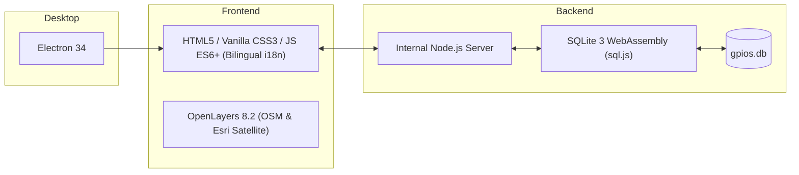

<div align="center">

# GPIOS
### Desktop Geographic Information System and Bird Field Notebook

[](https://github.com/synthbird-web/gpios/releases)
[](#supported-operating-systems)
[](#privacy-and-offline-persistence)
[](#key-features)
[](#license)

Developed by [Vision by Data](https://visionbydata.com)

</div>

---

## Overview

> *This app is a nonprofit project driven by scientific curiosity and dedicated to everyone who works to observe, study, and conserve birds.*

**GPIOS** is a cross-platform desktop application designed for birdwatchers, ornithologists, and field naturalists worldwide. It allows you to record, geo-reference, and manage bird observations during field outings anywhere on Earth.

Built with an offline-first architecture, your observational data is stored locally in an embedded SQLite database (`gpios.db`) powered by WebAssembly. The integrated mapping viewer connects globally to high-resolution satellite imagery and street maps.

> [!IMPORTANT]
> **Internet Connection Requirement for Maps:**  
> An active internet connection is required to fetch online map tiles (OpenStreetMap and Esri World Imagery satellite) and geocode place names via Nominatim. However, all bird data, field sessions, species catalogues (+11,000 species), and backup imports/exports remain 100% accessible and functional offline on your computer.

---

## Key Features

- **Worldwide GIS Mapping:**
  - Switchable global base layers: **Street Map (OpenStreetMap)** and high-resolution **Satellite Imagery (Esri World Imagery)**.
  - Interactive point-and-click coordinate pinning anywhere on Earth.
  - "My Area" instant navigation button tailored to your region.
- **Dynamic Boundary Framing & Smart Location:**
  - Automatically adjusts map zoom and view extents to the exact geographical boundaries of the selected entity (e.g. selecting Linares frames the municipality of Linares, selecting Jaén frames the province of Jaén, and selecting Spain frames the entire country).
  - Automatic position detection via device **GPS** or **IP geolocation** with anti-VPN/proxy heuristic checks (compares IP timezone against the local system clock to avoid misplacing you).
  - Manual place search powered by OpenStreetMap Nominatim.
- **Bilingual Interface (English & Spanish):**
  - Full interface support in English (default) and Spanish, switchable on the fly from the ⚙️ Settings gear.
  - Taxonomical species catalogue with over 11,000 global species, searchable by common name (English or Spanish), scientific name, or family with diacritic-insensitive normalization.
- **First-Run Onboarding & Profile:**
  - Configurable user profile on startup: set your name, language, and preferred home region.
  - Easily modify your profile anytime via the ⚙️ settings modal.
- **Field Session Management:**
  - Record sessions with custom title, date, time, location, typified weather conditions, and detailed species lists (count + field notes).
  - Direct full-session editing and deletion from the interactive history.
- **Data Interoperability:**
  - Localized **CSV** export encoded with UTF-8 BOM for seamless opening in Microsoft Excel.
  - Complete **JSON** backup export and import for database portability across computers.

---

## Supported Operating Systems

GPIOS is packaged as a standalone application ready to run:

| Operating System | Architecture | Package Format |
| :--- | :---: | :--- |
| **Windows** | x64 (Windows 10 / 11) | Portable archive (`.zip` containing `GPIOS.exe`) |
| **macOS (Apple Silicon)** | arm64 | Application bundle (`.zip` containing `GPIOS.app`) |
| **GNU / Linux** | x64 (Universal) | Standalone binary (`.AppImage`) |

*No need to install Node.js, Python, or external databases on the host machine.*

---

## Architecture & Technology Stack



- **Desktop Framework:** [Electron 34](https://www.electronjs.org/) with sandboxing, context isolation, and secure internal IPC.
- **Cartography:** [OpenLayers 8.2](https://openlayers.org/) rendering global XYZ and OSM tile services.
- **Database Engine:** SQLite 3 compiled to WebAssembly ([sql.js](https://sql.js.org/)) with transactional writes, atomic file flushing, and diacritic-insensitive matching.
- **Reverse Geocoding:** OpenStreetMap Nominatim API.

---

## Download & Installation

Pre-compiled binaries for version 1.0.0 are available in the [GitHub Releases](https://github.com/synthbird-web/gpios/releases) section and documented in [`releases/README.md`](releases/README.md):

- **Windows:** Extract `GPIOS-1.0.0-win.zip` and launch `GPIOS.exe`.
- **macOS (Apple Silicon):** Extract `GPIOS-1.0.0-arm64-mac.zip`, move `GPIOS.app` to `/Applications`, and run:
  ```bash
  xattr -cr /Applications/GPIOS.app
  codesign --force --deep --sign - /Applications/GPIOS.app
  ```
- **Linux:** Download `GPIOS-1.0.0.AppImage`, make it executable (`chmod +x GPIOS-1.0.0.AppImage`), and run.

---

## Local Development

```bash
# Install dependencies
npm install

# Start Electron application
npm start

# Run in browser without Electron (embedded server on http://localhost:8000)
npm run serve

# Run automated integration test suite
npm run test:server

# Build release packages
npm run build:linux        # Linux x64 AppImage
npm run build:win          # Windows x64 portable zip
npm run build:mac:arm64    # macOS Apple Silicon arm64 zip
```

---

## Privacy and Offline Persistence

- **Local Storage:** All user entries, notes, coordinates, and settings are saved exclusively on your local machine (`userData` directory in production).
- **Zero Telemetry:** No analytics, tracking, or user telemetry are included.
- **Offline Safety:** Data entry and queries continue working without network connection. Map rendering and Nominatim geocoding reconnect automatically when internet access is restored.

---

## License

Developed by [Vision by Data](https://visionbydata.com) under the **ISC** License.
